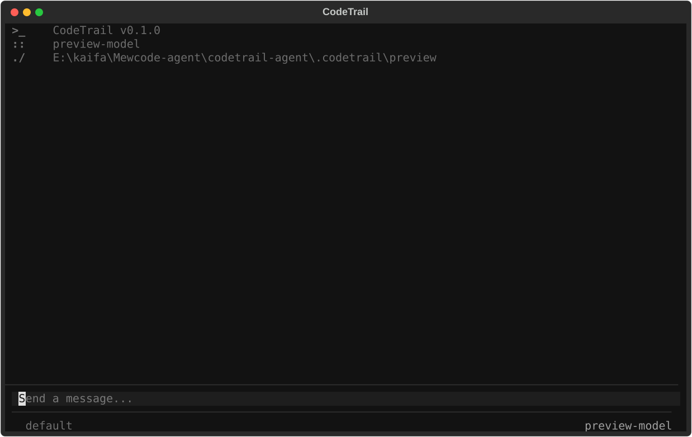

# CodeTrail

**在终端中阅读、理解和修改代码的 AI 编程助手。**

CodeTrail 是一款基于 Python 与 Textual 的终端 AI 编程助手，支持多模型接入、工具调用、会话管理和 MCP 扩展，并提供配置初始化与离线诊断。

`Python >= 3.11` · `Textual TUI` · `asyncio` · `MCP` · `pytest`



*真实 TUI 的离线启动预览，使用演示 Provider，未发送模型请求。*

## 能做什么

| 能力 | 内容 |
| --- | --- |
| 终端交互 | 流式对话、Slash 命令、文件引用 |
| 模型与工具 | Anthropic / OpenAI / 兼容协议、文件与命令工具、MCP |
| 任务与上下文 | 子 Agent、团队任务、Worktree、会话、压缩与记忆 |
| 快速初始化 | `--init` 生成配置，拒绝覆盖已有文件 |
| 本地诊断 | `--doctor` 检查配置、凭据和可执行命令；支持 JSON |
| 凭据配置 | 支持环境变量引用，提示缺失变量 |
| 独立配置与版本 | `--config`、`--version`，CLI / TUI 版本一致 |

## 快速开始

需要 Python 3.11+、[uv](https://docs.astral.sh/uv/) 和一个可用的模型 API 账号。Git 用于仓库与 Worktree 功能。

```powershell
git clone https://github.com/zhanglelelelezhou/Codetrail_Agent_Coding-Project.git
cd Codetrail_Agent_Coding-Project
uv sync --locked
uv run codetrail --init
```

初始化会生成 `.codetrail/config.yaml`。按自己的服务商修改 `protocol`、`base_url` 和 `model`；示例模型 ID 也应替换为账号可用的模型。密钥使用环境变量：

```powershell
# PowerShell：只对当前终端会话生效
$env:OPENAI_API_KEY = "替换成你的实际密钥"
uv run codetrail --doctor
uv run codetrail
```

macOS / Linux 使用 `export OPENAI_API_KEY="..."` 设置环境变量。真实 Key 和本地配置不提交到 Git。

`--doctor` 只进行本地检查，不请求模型、不启动 MCP、不执行 Hook。缺少密钥时退出码为 1，通过时为 0；通过不代表服务端凭据、模型权限和网络已验证。

## 常用操作

```powershell
uv run codetrail --help
uv run codetrail --version
uv run codetrail --doctor --json
uv run codetrail --config .codetrail/config.local.yaml --doctor
uv run codetrail --mode plan
```

在 TUI 中使用 `/help`、`/status`、`/session`、`/mcp`、`/review` 等命令；用 `@文件名` 引用文件。`--mode` 使用源码中的实际值：`default`、`acceptEdits`、`plan`、`bypassPermissions`。

配置默认依次加载 `~/.codetrail/config.yaml`、项目 `.codetrail/config.yaml`、项目 `.codetrail/config.local.yaml`。`--config PATH` 只读取指定文件。

原有 `-p` 非交互模式和 `--remote` 仍保留，演示前请阅读 [已知边界](docs/ARCHITECTURE.md#已知边界)。远程模式默认监听 `0.0.0.0:18888`，未在本次改造中完成访问控制和真实网络验证。

## 开发与验证

在项目根目录执行：

```powershell
uv sync --locked
uv run pytest
uv build
```

测试使用模拟模型与临时目录；部分真实接口或外部环境测试会跳过。新增测试覆盖初始化保留文件、凭据解析、诊断脱敏、错误退出码和 CLI 行为。实际验证结果见 [验证记录](docs/VALIDATION.md)。CI 配置不等同于已在 GitHub 上运行成功。

```text
codetrail/
  __main__.py       CLI、TUI 与单次执行入口
  onboarding.py     初始化和离线诊断
  config.py         配置加载、凭据与模型参数
  agent.py          模型与工具执行循环
  client.py         多协议客户端
  tools/            内置工具与注册表
  permissions/      权限规则与路径检查
  agents/ teams/    子 Agent 与团队调度
  context/ memory/  上下文、会话和记忆
  mcp/ worktree/    外部工具与隔离工作目录
tests/              原有与新增测试
docs/               架构、配置、变更与验证记录
```

## 从 MewCode 配置迁移

新命令是 `codetrail`，Python 包名是 `codetrail`，项目指令文件是 `CODETRAIL.md`。运行状态保存在 `.codetrail`，不会自动读取旧 `.mewcode`。建议重新初始化并复制必要配置，旧会话与权限文件不自动迁移。

## 来源与许可

CodeTrail 在 MewCode 教程源码基础上进行二次开发，保留原始署名。来源、许可状态与版本变更见 [NOTICE](NOTICE.md) 和 [变更记录](docs/CHANGES.md)。

**公开发布前需要核实课程源码的分发许可。** ZIP 缺少根目录 LICENSE，本版本没有自行宣称整个项目采用 MIT。详情见 [NOTICE](NOTICE.md)。

- [架构与阅读路线](docs/ARCHITECTURE.md)
- [改造记录与后续方向](docs/CHANGES.md)
