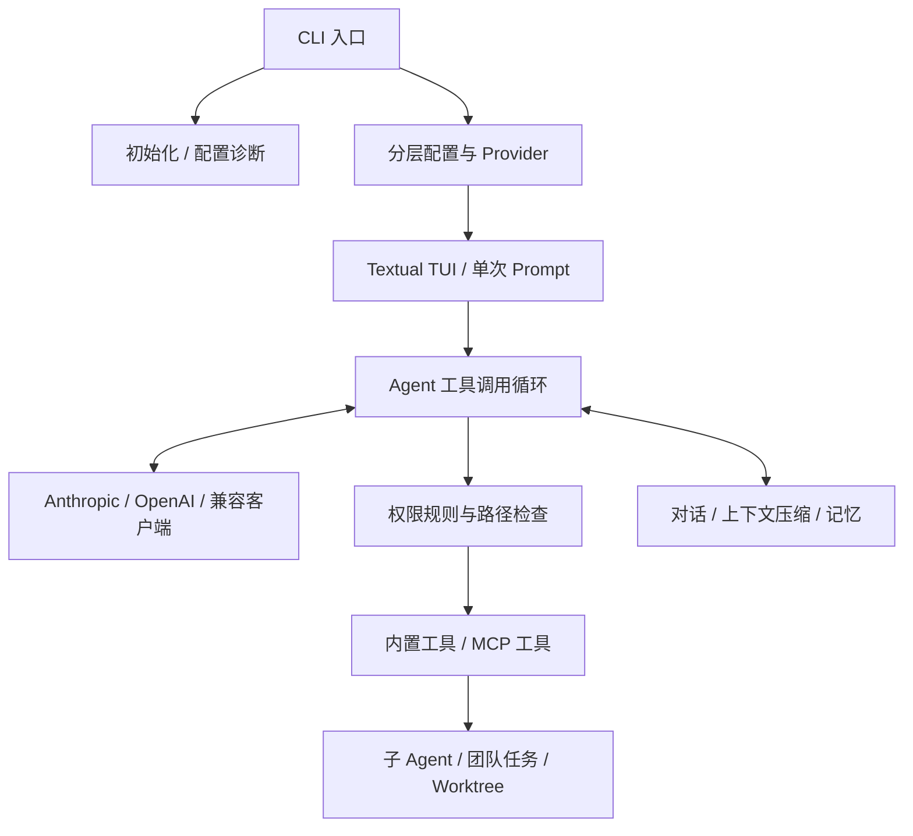

# 架构与阅读路线

## 一次交互如何执行

1. `__main__.py` 解析参数。版本、初始化和诊断分支在启动 TUI、日志和模型客户端之前执行。
2. `config.py` 读取用户、项目、本地覆盖配置；`validator.py` 校验结构。显式 `--config` 只读取指定文件。
3. TUI 收集消息，`agent.py` 驱动模型响应与工具调用事件；`client.py` 负责协议差异。
4. 工具通过注册表查找，执行前经过权限判断，结果写回对话，继续下一轮。
5. 长对话由 `context/` 管理，`memory/` 与会话文件处理持久化。

## 本次新增模块的设计选择

- **诊断离线运行**：验证本地配置和依赖命令，不连接模型、不启动 MCP、不执行 Hook。因此“诊断通过”不表示远程凭据、模型权限或网络一定可用。
- **只报告检查结果**：不会把 API Key、请求头和完整配置序列化到报告中。配置错误只展示错误类别，避免 YAML 错误上下文包含密钥。
- **初始化拒绝覆盖**：创建文件时使用独占写入；保留已有配置，避免覆盖个人设置。
- **配置目录隔离**：采用 `.codetrail`，不会自动读取旧 `.mewcode` 配置。已有用户按迁移说明复制所需设置。

## 已知边界

- 模型调用、远程模式、第三方 MCP 和多进程队友需要分别进行真实环境验证；离线测试不能替代这些验证。
- 原有非交互 `-p` 分支会自动批准需要询问的工具权限；使用前先阅读 `__main__.py` 的 `PermissionRequest` 分支。在独立工作目录演示，不把它宣传为安全沙箱。
- 原始实现的 OS 沙箱面向特定操作系统；Python 可安装不代表所有工具行为都跨平台一致。
- 当前配置分层合并还有边界：部分布尔开关不能由后层显式关闭。后续重构需要为“字段未设置”建模。
- `--config` 应用于当前 CLI 进程；外部 tmux / iTerm2 队友仍使用默认配置发现路径，独立配置尚未自动传递给这些进程。

## 建议阅读顺序

先阅读 `config.py → onboarding.py → tools/base.py → conversation.py → client.py → agent.py`，再看 `permissions/` 和 `app.py`。最后研究 `agents/`、`teams/` 与 `worktree/`，沿调用链理解用户输入如何转换为工具执行及结果。
